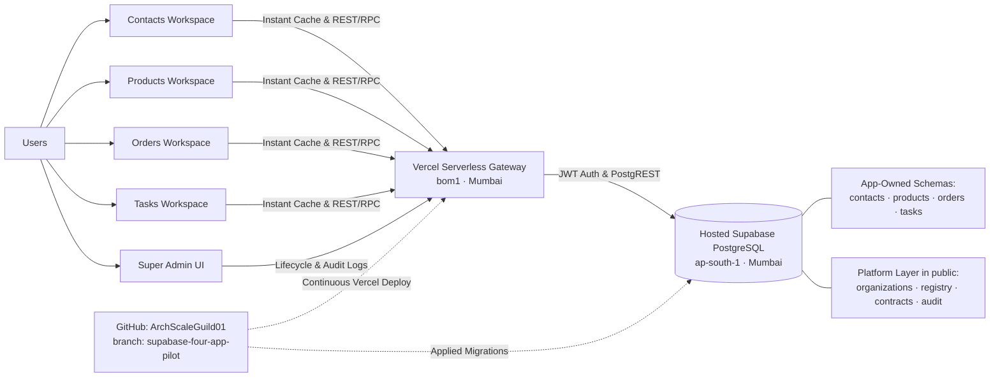

# Manager Update — Four-App Modular Demo

**Status:** Presentable staging release deployed on Vercel backed by a dedicated hosted Supabase PostgreSQL database in Mumbai (`ap-south-1`). Features four independent app workspaces, reciprocal record linking with display snapshots, platform Super Admin lifecycle controls, and sub-100ms loading speeds.

## Architecture at a glance

## Completed

- **Four Independent App Workspaces**: Contacts, Products, Orders, and Tasks run on their own dedicated workspace URLs with instant cross-tab local caching (`localStorage`) and zero blank-screen latency.
- **Dedicated Hosted Supabase Database**: Deployed on Supabase Cloud (`djechswitjpwajqtwfig`, region `ap-south-1`). Each app owns its isolated database schema (`contacts`, `products`, `orders`, `tasks`), while identity, tenancy, contracts, and audit logging live in `public`.
- **4-Way Reciprocal Linking with Display Snapshots**: Records link across apps using soft IDs and frozen text snapshots. If a linked record or an entire app schema is deleted, sibling apps remain 100% stable with historical snapshot fallbacks.
- **Single-Roundtrip Performance Optimization**: Collapsed 4 sequential database queries into a single PostgreSQL RPC (`public.get_platform_state()`) executed in ~2ms, co-located in Mumbai (`bom1` ↔ `ap-south-1`) for sub-100ms response times.
- **Super Admin Lifecycle Controls**: Complete management panel supporting `activate`, `deactivate`, `retire`, `delete_data`, and `remove_schema` (preserving schema stubs to keep PostgREST cache healthy) with tamper-evident audit logging.
- **Hosted Staging Deployment**: Live on Vercel at `https://archscale-four-apps-staging.vercel.app` synced with GitHub repository `Ritikkeshari07/ArchScaleGuild01` on branch `supabase-four-app-pilot`.

## Record changes vs. code changes

- **Record changes:** App form submissions go through Vercel serverless endpoints and are written directly to that app's schema in Supabase (`contacts.contacts`, `products.products`, `orders.orders`, `tasks.tasks`). Other apps read them through the platform state API or local cache.
- **Code changes:** Pushing source to GitHub branch `supabase-four-app-pilot` triggers automated production builds on Vercel. Code pushes do not modify business records; schema updates require explicit SQL migrations via `supabase db push`.
- **Real-time consistency:** App tabs share an instant `localStorage` model cache and poll shared state every 8 seconds when the tab is visible. Unsaved drafts in open forms are automatically preserved.

## Deletion boundaries

- **Delete app records (`delete_data`):** Clears only records owned by that selected app; sibling apps retain their saved snapshots and remain fully editable.
- **Deactivate or retire an app:** Toggles the app's operational status (`inactive` or `retired`) while keeping all data intact.
- **Remove app schema (`remove_schema`):** Drops the app-owned schema and integration contracts. It leaves a clean empty schema stub so PostgREST's catalog introspection remains healthy, while sibling apps continue operating without disruption.
- **Reset demo data:** Re-seeds the baseline 4-way linked demo story (`ABC Studio` ↔ `Marble Sample` ↔ `ORD-001` ↔ `Confirm delivery`) without affecting platform admin access.

## Live workspaces

- **Staging URL:** [archscale-four-apps-staging.vercel.app](https://archscale-four-apps-staging.vercel.app)
- **Contacts Workspace:** [archscale-four-apps-staging.vercel.app/apps/contacts](https://archscale-four-apps-staging.vercel.app/apps/contacts)
- **Products Workspace:** [archscale-four-apps-staging.vercel.app/apps/products](https://archscale-four-apps-staging.vercel.app/apps/products)
- **Orders Workspace:** [archscale-four-apps-staging.vercel.app/apps/orders](https://archscale-four-apps-staging.vercel.app/apps/orders)
- **Tasks Workspace:** [archscale-four-apps-staging.vercel.app/apps/tasks](https://archscale-four-apps-staging.vercel.app/apps/tasks)
- **Super Admin Panel:** [archscale-four-apps-staging.vercel.app/admin](https://archscale-four-apps-staging.vercel.app/admin)

## Verification & Status

- **Automated test suite (`npm test`):** 7 passed, 0 failed.
- **Full live acceptance suite:** All 13 live staging verification points passed (signup, bootstrap admin, 4-way reciprocal record linking, lifecycle actions, delete isolation, schema removal, session termination).
- **Latency & Performance:** Serverless edge functions co-located in Mumbai (`bom1`) matching Supabase (`ap-south-1`), with instant `localStorage` multi-tab sync ensuring sub-100ms transitions.
