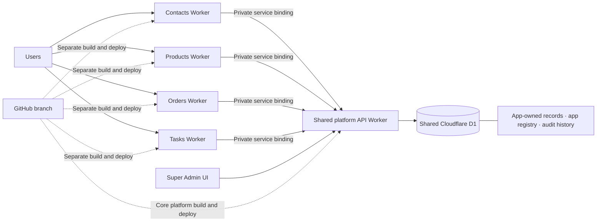

# Four Interdependent Apps — Modularity Demo

## Supabase four-app local pilot

The `supabase-four-app-pilot` branch includes Contacts, Products, Orders, and Tasks. The Tasks workspace is added with a forward-only migration, preserving the local account and existing records. It uses local Supabase Auth, organization membership, app-scoped write access, RLS, lifecycle controls, and linked sample records. The local Node server stores the Supabase session in HttpOnly cookies so one sign-in works across the dashboard and all workspace routes on this origin. Existing D1 demo files remain for comparison; run the Supabase pilot with `Run-Supabase-Pilot.cmd` or `npm run start:supabase`, not `npm start`.

The local schema boundary migration moves app-owned records into `contacts`, `products`, `orders`, and `tasks` schemas. The permanent platform tables stay in `public`. Super Admin's **Remove schema** action is an ecosystem-wide uninstall for this disposable local pilot: it drops the selected app schema, removes contracts involving that app, and preserves reference IDs and display snapshots in the remaining app schemas. The other workspaces keep manual snapshot entry available when that app is no longer installed.

### Start the local pilot

Requirements: Node.js 20 or later, Docker Desktop running, and the Supabase CLI.

1. Open Docker Desktop and wait until it reports that the engine is running.
2. Double-click `Run-Supabase-Pilot.cmd` from this folder. On first run, Supabase downloads its local service images and applies the migrations and sample data. Copy the Project URL and Publishable key from its output when prompted; they are saved to the ignored `.env.local` file.
3. Open the local app at `http://127.0.0.1:3000`, choose **Create local account**, and sign up with your email and a password.
4. Open Supabase Studio at `http://127.0.0.1:54323`. In SQL Editor, open `supabase/bootstrap_admin.sql`, replace both occurrences of `replace-with-your-email@example.com` with your signup email, and run it. This grants that local account pilot-admin access to all four apps.
5. Sign in or reload the app. The seeded ABC Studio, Marble Sample, ORD-001, and Confirm delivery records should appear, linked across all four apps.
6. If upgrading an existing three-app local database, apply the Tasks migration with `supabase migration up --local`. Do not reset the database; the migration preserves existing records and grants Tasks access to current platform admins.

This local setup is for sample data only. The hosted production cutover, backup and recovery plan, and independent security review still need to happen before real users or business data are added. Never put a Supabase secret key in `.env.local` or browser code; this pilot uses the publishable key and the signed-in user token for app requests.

### Vercel staging preparation

The Supabase pilot now has a Vercel Node Function entry point at `api/[...path].mjs`; static pages remain under `public/`. For the first staging deployment, import the GitHub branch as one Vercel project with this folder (`modular-demo`) as its Root Directory and the Other framework preset. No build command is required. Configure `SUPABASE_URL` and `SUPABASE_PUBLISHABLE_KEY` as Vercel environment variables; never add a Supabase secret/service-role key. The local Node server remains available with `npm run start:supabase`.

This is a staging adapter, not a production approval. Hosted staging still needs migration/security review, a new Supabase project, an admin bootstrap for the hosted user, and an end-to-end check of auth redirects and app lifecycle actions. Start with the Vercel preview domain; configure separate app domains and central sign-in after the preview flow is verified.

A local, dependency-free Node.js prototype for demonstrating the assigned modularity work: Contacts, Products, Orders, Tasks, optional app integrations, saved snapshots, and Super Admin lifecycle controls.

## Run

Requirements: Node.js 18 or newer. From this folder:

```powershell
npm start
```

Open the address printed in the command window (normally http://127.0.0.1:3000). If that port is already in use, the server tries the next available port automatically. The home page launches four separate app workspaces:

- Contacts: `<server-address>/apps/contacts`
- Products: `<server-address>/apps/products`
- Orders: `<server-address>/apps/orders`
- Tasks: `<server-address>/apps/tasks`
- Super Admin: `<server-address>/admin`

Each app has its own page, URL, and backend module. The apps share the platform API so each app can link to the other three. Click **Load demo story** on the home page or Super Admin page for ABC Studio → Marble Sample (₹500) → ORD-001 (4 items, ₹2,000) → Confirm delivery. The sample records include links across all four apps. Use Super Admin controls to deactivate, retire, reactivate, or delete one app's records. The local Node server stores data in `data/store.json`; the hosted Cloudflare demo stores data in app-owned D1 tables.

Run the automated checks with `npm test`.

## Hosted preview (demo only)

## Architecture at a glance



The platform Worker (`src/worker.mjs`) owns the D1 database and API. Migration `0002_app_owned_tables.sql` moves hosted demo records into separate Contacts, Products, Orders, and Tasks tables while preserving IDs and display snapshots. Migration `0003_independent_deployments.sql` tracks each app's Worker and repository path separately from data lifecycle. App Worker packages are generated one at a time with `node scripts/build-app.mjs contacts` (or `products`, `orders`, `tasks`); each app calls the shared platform through a Cloudflare Service binding. A revision check rejects simultaneous stale writes. Run `npm run build:apps` to generate all four Worker packages locally, or use `npm run build:contacts`, `build:products`, `build:orders`, or `build:tasks` for one app. The hosted demo requires a `DEMO_PASSWORD` secret and fails closed for API access until it is configured.

To preview locally with Cloudflare, run `npm run cf:dev` after authenticating Wrangler and creating `.dev.vars` with a `DEMO_PASSWORD` value. Apply the migration with `npx wrangler d1 migrations apply archscale-four-apps-demo --local`. Deploy with `npm run cf:deploy` after applying it remotely with `npx wrangler d1 migrations apply archscale-four-apps-demo --remote` and adding the `DEMO_PASSWORD` secret in Cloudflare. For automated Git deployments, connect this Worker to the `modular-four-apps-demo` GitHub branch through Workers Builds.

This remains a manager-review demo, not production: the password gate is shared access, not user accounts or RBAC. The four Worker packages and service bindings establish independent deployment boundaries around one stable data/API service. The four independent app Workers are deployed from the modular-four-apps-demo branch and are listed in MANAGER-UPDATE.md. App workspace pages display a sign-in form for the configured demo password. The password is sent only to the shared API and is held in memory for the current browser tab. App records and shared D1 are deliberately separate from Worker deployment, so removing an app Worker does not cascade into another app's records. Use sample data only. Before production, add real authentication/authorization, reviewed migrations, backups, and audit retention.

## Record changes vs. code changes

- **Record changes:** a user saves a Contact, Product, Order, or Task in its app; that app Worker forwards the request through its private service binding to the platform API, which writes the app-owned D1 table. The other apps can read the shared record and its saved link snapshots when they load or refresh.
- **Code changes:** a source commit to `modular-four-apps-demo` triggers the configured Cloudflare Worker Builds and deploys the affected Worker packages. A code push does not itself change business records; database structure changes need an explicit migration.
- While a signed-in tab is visible, the demo polls shared state every five seconds and updates the app tables and selectors automatically. Polling pauses for hidden tabs and defers rerendering while a create form is being edited. This is lightweight polling, not push notifications.

## Folder structure

- `src/platform/` — module registry, local JSON adapter, Cloudflare D1 adapter, validation, and lifecycle policy.
- `src/apps/{contacts,products,orders,tasks}/` — independent app logic and manifests.
- `scripts/build-app.mjs` — generates one app Worker package at a time with its own URL, assets, and service binding to the shared platform API.
- `deployables/{contacts,products,orders,tasks}/` — generated, independently deployable Cloudflare Worker packages (created by the build script).
- `public/apps/{contacts,products,orders,tasks}/` — separate app entry pages, with shared styling and client helpers.
- `public/admin/` — Super Admin registry and lifecycle controls.
- `public/` — app launcher and shared styling/client helpers.
- `test/` — module removal and snapshot behavior tests.
- `data/store.json` — local disposable demo database, created on first run.

## Behaviors demonstrated

- Every app can optionally link to each of the other three apps. The create forms allow selecting existing records or entering snapshot text.
- Contacts can link to Products, Orders, and Tasks; Products can link to Contacts, Orders, and Tasks; Orders can link to Contacts, Products, and Tasks; Tasks can link to Contacts, Products, and Orders.
- Linked records keep display snapshots so the other apps continue working if a related app's records are removed.
- Orders save unit price, quantity, and total at creation. Tasks save their order, contact, and product display references.
- Deactivate/retire disables the selected app while preserving its records.
- Delete clears only the selected app's owned collection. Other apps' saved snapshots remain.
- Each app has its own browser workspace URL while sharing the platform API and local database.
- App workspaces do not include links or tabs to switch directly to another app. Open workspaces from the launcher or their URLs; inter-app connections are made through record selectors and saved references.
- Super Admin UI actions are intentionally unauthenticated for the localhost demo. This is not production security.

## Reference and scope

The modular addon/folder and manifest concept was informed by [ProjectMeru/sumeru](https://github.com/ProjectMeru/sumeru) and [ProjectMeru/sumeru_addons](https://github.com/ProjectMeru/sumeru_addons). This prototype is original implementation code, not copied Sumeru source. Sumeru is pre-alpha and its sample Sales addon declares dependencies on Products, Contacts, and CRM, so it is an architecture reference rather than proof of safe removal. See its [Apache-2.0 license](https://github.com/ProjectMeru/sumeru_addons/blob/main/LICENSE).

## Live acceptance check

Use [LIVE-ACCEPTANCE-CHECKLIST.md](LIVE-ACCEPTANCE-CHECKLIST.md) for step-by-step hosted tests covering four-way links, deactivate/retire, delete-data isolation, and demo reset.

## Known gaps before production

This is a proof of concept. The local Node server uses a JSON file; the hosted platform uses separate D1 tables with migrations and optimistic concurrency checks. The four app Workers and shared platform have been deployed through Cloudflare Workers Builds, and each app's live `/health` endpoint has been verified. The app-to-platform route has been checked with an invalid-password response; a valid-password record exchange and Super Admin action still need manual end-to-end verification. There is no user-level RBAC, production-grade audit retention, backup/restore workflow, or production deletion policy. The **Load demo story** reset restores sample data and active app statuses while preserving deployed Worker metadata. The “Delete data” action clears only that app's records; removing a Worker is a separate deployment operation, and deleting the repository is separate from both. Do not use real business data.
