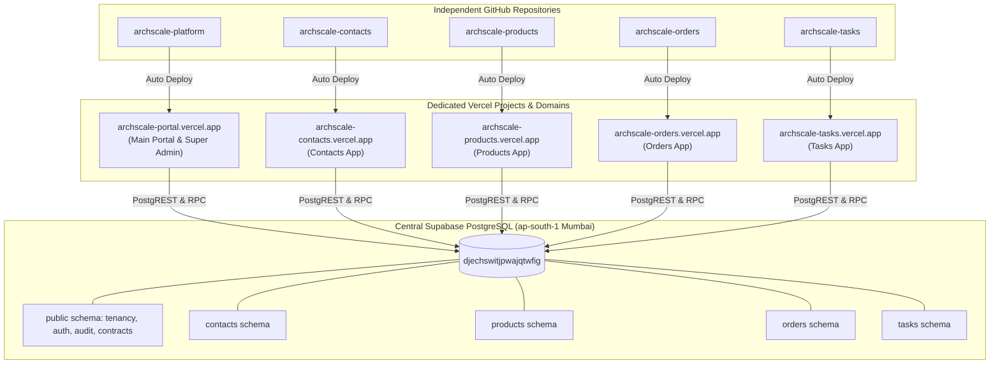
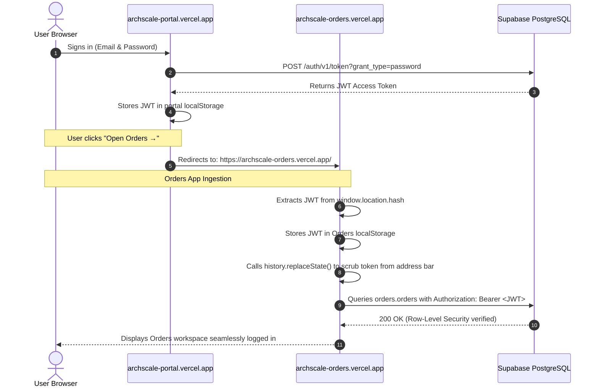

# ArchScale Multi-Repo & Multi-Domain Architecture Workflow

**Status:** Approved Architectural Blueprint  
**Target Architecture:** Polyrepo (5 Independent Repositories) + Multi-Domain Vercel Deployments + Central Hosted Supabase Database  
**Author:** ArchScale Engineering Team  
**Last Updated:** October 2026

---

## 1. Executive Summary & Objective

This document defines the complete technical workflow, repository topology, deployment architecture, and security boundaries for transitioning ArchScale from a single-repository pilot into a **Multi-Repository, Multi-Domain System**.

### Primary Business & Engineering Objectives:
1. **Developer Code Isolation**: External developers and contractors assigned to a specific app (e.g. Orders) must only have access to that app's repository. They cannot view, clone, or tamper with the platform core or other applications' source code.
2. **Independent Deployments & Domains**: Each application runs on its own isolated Vercel project and public domain (`archscale-contacts.vercel.app`, `archscale-orders.vercel.app`, etc.) with independent build pipelines and rollback capabilities.
3. **Unified Identity & Database Governance**: All apps connect to a single central Supabase PostgreSQL staging/production database with strict Row-Level Security (RLS) and schema isolation (`contacts`, `products`, `orders`, `tasks`, `public`).
4. **Seamless Cross-Domain Single Sign-On (SSO)**: Users sign in once at the main portal and navigate between application domains without password re-prompts or broken sessions.

---

## 2. Multi-Repository Topology

The codebase will be split into **5 distinct GitHub repositories**:

```text
GitHub Organization / Account (Ritikkeshari07)
│
├── 1. archscale-platform (PRIVATE - Core Team Only)
│   ├── Platform Portal Web UI (Dashboard & App Launcher)
│   ├── Super Admin Management Panel (/admin)
│   ├── API Gateway & Serverless Router (/api/*)
│   ├── Master Database Blueprints (supabase/migrations/)
│   └── Reusable UI Component Library (@archscale/ui)
│
├── 2. archscale-contacts (Assigned Contacts Team)
│   ├── Contacts Workspace UI
│   ├── Contacts Domain Validation & Model Logic
│   └── Local Dev Mock Server / Test Suite
│
├── 3. archscale-products (Assigned Products Team)
│   ├── Products Catalog & SKU Workspace UI
│   └── Product Domain Logic & Pricing Calculations
│
├── 4. archscale-orders (Assigned Orders Team)
│   ├── Orders Creation & Line-Item Workspace UI
│   └── Order Calculation & Linkage Logic
│
└── 5. archscale-tasks (Assigned Tasks Team)
    ├── Tasks Follow-up & Coordination Workspace UI
    └── Task Assignment & Due-Date Domain Logic
```

---

## 3. Independent Domain & Deployment Architecture

Each repository connects to its own independent Vercel project on the Vercel Hobby plan:



---

## 4. Cross-Domain Single Sign-On (SSO) Protocol

Because browsers treat distinct `*.vercel.app` subdomains as separate origins, authentication cookies cannot be shared directly. We implement a secure **URL Hash Token Handoff Protocol**:



### Security Considerations:
* **Token Exposure Prevention**: The session token is transmitted in the URL **hash fragment (`#session=...`)**, not in query parameters (`?session=...`). Hash fragments are **never sent to web servers** in HTTP headers and are not logged in CDN access logs.
* **Immediate Cleanup**: As soon as `app.js` initializes on the destination app, it calls `history.replaceState(null, '', window.location.pathname)` so the token disappears from the browser history.

---

## 5. CORS & API Security Configuration

The API gateway in `archscale-platform` enforces an allowed origins whitelist:

```javascript
const ALLOWED_ORIGINS = [
  'https://archscale-portal.vercel.app',
  'https://archscale-contacts.vercel.app',
  'https://archscale-products.vercel.app',
  'https://archscale-orders.vercel.app',
  'https://archscale-tasks.vercel.app'
];

export function handleCors(req, res) {
  const origin = req.headers.origin;
  if (ALLOWED_ORIGINS.includes(origin) || !origin) {
    res.setHeader('Access-Control-Allow-Origin', origin || '*');
    res.setHeader('Access-Control-Allow-Methods', 'GET, POST, OPTIONS');
    res.setHeader('Access-Control-Allow-Headers', 'Content-Type, Authorization');
    res.setHeader('Access-Control-Allow-Credentials', 'true');
  }
}
```

---

## 6. Database Blueprint & Migration Governance

### Centralized Migration Master:
* All database migrations live strictly inside **`archscale-platform/supabase/migrations/`**.
* The Supabase CLI and deployment keys are managed exclusively by the platform team.
* **Contractor / App Developer Workflow**:
  - Developers working on `archscale-orders` receive a local staging environment variable set containing only:
    - `SUPABASE_URL`
    - `SUPABASE_PUBLISHABLE_KEY` (Anon key)
    - Test credentials restricted by Row-Level Security (RLS) to `'orders'`.
  - Developers **never receive the `service_role` master key**.
  - If the Orders app requires a new database column, the developer creates a pull request against `archscale-platform` with their SQL migration (e.g. `20261105_orders_add_discount.sql`), which is reviewed and pushed by the platform owner.

---

## 7. Migration Execution Plan (Step-by-Step)

1. **Phase 1: UI Upgrade & Component Finalization (Current Focus)**
   - Complete the modern UI revamp across all app workspaces, navigation bars, and forms before repository extraction.
2. **Phase 2: Platform Core Extraction**
   - Create GitHub repo `archscale-platform`.
   - Implement the CORS whitelist and `#session` SSO receiver in the reusable client runtime.
   - Deploy `archscale-portal.vercel.app`.
3. **Phase 3: App Repositories Extraction**
   - Extract `archscale-contacts`, `archscale-products`, `archscale-orders`, `archscale-tasks` into dedicated repositories.
   - Deploy each to its corresponding Vercel project.
4. **Phase 4: Multi-Domain Verification**
   - Perform end-to-end testing across all 5 independent domains.
   - Verify that deleting data or removing schemas from the Super Admin portal gracefully falls back to snapshots across independent app domains.
